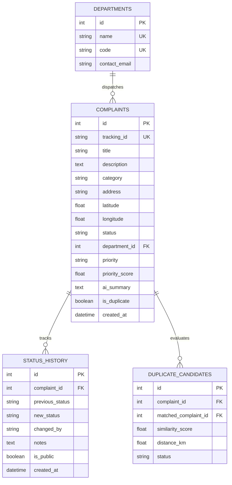

# CivicSense AI — Technical Architecture & Algorithmic Blueprint

## 1. System Philosophy: CAPTURE → UNDERSTAND → REVEAL → ACT

CivicSense AI treats civic operations as a closed-loop intelligence pipeline. The system replaces subjective human dispatching with an explainable, deterministic machine learning pipeline coupled with spatial intelligence.

```
+-----------------------------------------------------------------------------------+
|                                  CAPTURE                                          |
|  - Mobile-First Reporting Wizard                                                  |
|  - Geocoded Coordinates & Map Snapping                                            |
|  - Drag-and-Drop Image Ingestion                                                  |
+-----------------------------------------------------------------------------------+
                                        |
                                        v
+-----------------------------------------------------------------------------------+
|                                 UNDERSTAND                                        |
|  - Category Classification & Confidence Evaluation                                |
|  - Factual Operational Summarization (Strictly Non-Hallucinatory)                 |
|  - TF-IDF Cosine Lexical Similarity + Haversine Spatial Deduplication             |
|  - 5-Factor Weighted Urgency Score (0 - 100) with Explainable Triggers            |
+-----------------------------------------------------------------------------------+
                                        |
                                        v
+-----------------------------------------------------------------------------------+
|                                   REVEAL                                          |
|  - Leaflet & OpenStreetMap Priority-Coded Telemetry                               |
|  - Multi-Category Hotspot Detection (Radius Clustering & Failure Correlation)     |
|  - Real-Time Executive KPI Telemetry & Ingestion Trends (Recharts)                |
+-----------------------------------------------------------------------------------+
                                        |
                                        v
+-----------------------------------------------------------------------------------+
|                                    ACT                                            |
|  - Department Work Order Dispatching (Roads, Drainage, Waste, Streetlights, etc.) |
|  - Administrative Priority Overrides with Mandatory Justification                |
|  - Status Transitions (Submitted -> Under Review -> Assigned -> In Progress ->   |
|    Resolved) with Immutable Audit Trails                                          |
|  - Synchronized Public Citizen Tracking Portal                                    |
+-----------------------------------------------------------------------------------+
```

---

## 2. Algorithmic Specifications

### A. Automatic Categorization Engine (`app/ai/classifier.py`)
- **Methodology:** Preprocessed token matching across 8 standard municipal taxonomies (Road Damage, Waterlogging, Waste Management, Streetlight Issues, Water Supply, Drainage, Public Safety, Other).
- **Weighting:** Title terms receive 3x multiplier over general description text.
- **Confidence Computation:**
  $$C = \min\left(0.95, \, 0.55 + \frac{S_{\text{top}}}{S_{\text{total}} + 2} \times 0.30 + \Delta_{\text{margin}} \times 0.05\right)$$
  Where $\Delta_{\text{margin}}$ is the differential between top and runner-up category scores.

### B. Actionable Operational Summarization (`app/ai/summarizer.py`)
- **Design Rule:** Never hallucinate unmentioned injuries, structural catastrophes, or emergency statuses.
- **Synthesis:** Extracts core phenomenon, locates street entity/landmark, and pairs with verified functional disruptions (e.g., pedestrian obstruction, vehicular stalling, hospital transit hindrance).
- **Sample Output:** *"Severe stormwater inundation near Sony World Junction, disrupting vehicular traffic and affecting sensitive local institutions."*

### C. Multi-Factor Duplicate Detection (`app/ai/duplicate_detector.py`)
Municipalities often receive 10-30 separate phone calls or complaints for the same burst pipeline or intersection sinkhole. CivicSense AI combines lexical NLP with geographic physics:
1. **Haversine Distance:**
   $$a = \sin^2\left(\frac{\Delta \phi}{2}\right) + \cos(\phi_1)\cos(\phi_2)\sin^2\left(\frac{\Delta \lambda}{2}\right)$$
   $$d = 2R \cdot \text{atan2}(\sqrt{a}, \sqrt{1 - a})$$
2. **TF-IDF Cosine Similarity:**
   Computes Term Frequency-Inverse Document Frequency vectors across active local reports in the same or adjacent civic domain.
3. **Composite Scoring:**
   $$\text{Score}_{\text{composite}} = \text{Sim}_{\text{TF-IDF}} + \text{Boost}_{\text{geo}}$$
   Where proximity $\le 150\text{m}$ provides a $+0.35$ boost for identical categories. Candidates with $\text{Score} \ge 0.45$ within $1.0\text{km}$ are flagged for administrative confirmation without deleting original reports.

### D. Explainable 5-Factor Priority Scoring (`app/ai/prioritizer.py`)
Scores every complaint on a transparent $0 - 100$ scale:
$$\text{Priority Score} = \text{Safety} (35) + \text{Urgency} (25) + \text{Community Impact} (20) + \text{Repeat Density} (10) + \text{Location} (10)$$

- **Critical:** $85 - 100$ (e.g. snapped high-voltage wire in flooded street outside emergency hospital ward)
- **High:** $65 - 84$ (e.g. major feeder pipeline rupture on arterial highway)
- **Medium:** $40 - 64$ (e.g. deep pothole on residential street, localized gutter block)
- **Low:** $0 - 39$ (e.g. broken ornamental paver tile, isolated uncollected bin)

Administrators retain full authority to override priority with mandatory audit justification.

### E. Autonomous Hotspot Clustering (`app/ai/clustering.py`)
- Groups non-resolved complaints within a $1.0\text{km}$ spatial radius where $N \ge 3$.
- Analyzes multi-category co-occurrences (e.g. repeated waterlogging + drainage overflow + road cratering) to identify systemic infrastructure failure rather than isolated incidents.
- Synthesizes automated action briefs with field investigation recommendations.

---

## 3. Database Architecture & Relationships



---

## 4. REST API Endpoint Catalog

| Method | Endpoint | Description | Public / Protected |
|---|---|---|---|
| `POST` | `/api/v1/complaints` | Register citizen complaint (multipart photo support) | Public |
| `GET` | `/api/v1/complaints` | Filter complaints by category, priority, status | Protected / Admin |
| `GET` | `/api/v1/complaints/{id}` | Inspect full complaint with AI breakdown | Protected / Admin |
| `GET` | `/api/v1/complaints/track/{tracking_id}` | Public-safe citizen tracking view | Public |
| `PATCH` | `/api/v1/complaints/{id}/status` | Transition status with audit log | Protected / Admin |
| `PATCH` | `/api/v1/complaints/{id}/assign` | Assign department work order | Protected / Admin |
| `PATCH` | `/api/v1/complaints/{id}/priority` | Override priority with recorded reason | Protected / Admin |
| `POST` | `/api/v1/complaints/{id}/duplicate/{c_id}/confirm` | Confirm duplicate candidate linkage | Protected / Admin |
| `POST` | `/api/v1/complaints/{id}/duplicate/{c_id}/dismiss` | Dismiss candidate as distinct issue | Protected / Admin |
| `GET` | `/api/v1/dashboard/stats` | KPI telemetry & chart distributions | Protected / Admin |
| `GET` | `/api/v1/dashboard/hotspots` | Active spatial cluster briefs | Protected / Admin |
| `POST` | `/api/v1/ai/analyze` | Dry-run AI pre-analysis preview | Public |
| `POST` | `/api/v1/auth/login` | Administrator authentication | Public / Admin |
