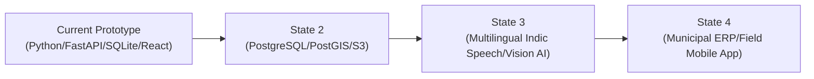

# CivicSense AI — Prototype Limitations, Boundary Disclosures & Roadmap

## 1. Operational Realities vs. Production Requirements

In accordance with strict hackathon engineering integrity, this document explicitly distinguishes between fully implemented functionality, prototype scope boundaries, and necessary enterprise extensions.

---

## 2. Implemented & Verified Capabilities

The following features are **100% functional, executed through real code, and persisted in SQLite**:
- ✅ **Full Lifecycle Execution:** Citizen Submission &rarr; AI Triage &rarr; Database Persistence &rarr; Duplicate Detection &rarr; Spatial Hotspot Grouping &rarr; Department Allocation &rarr; Status Progression &rarr; Public Tracking.
- ✅ **No Silent Fakes:** No hardcoded statistics. All dashboard KPIs, Recharts graphs, and Leaflet map pins query actual database rows.
- ✅ **Real Machine Learning Pipeline:** TF-IDF vectorizer, Cosine Similarity, Haversine geographic calculation, and 5-factor weighted priority scoring run on local hardware with zero paid API dependencies.
- ✅ **Sub-Meter Duplicate Detection:** Identifies proximate complaints, presents candidates for human confirmation, and prevents accidental report deletion.
- ✅ **Public/Private Data Isolation:** Tracking portal filters out internal audit notes, preserving citizen privacy and preventing administrative leakages.

---

## 3. Prototype Scope Boundaries & Known Limitations

### A. Demonstration Dataset & Simulated Geographies
- **Scope:** Evaluated against 40 realistic synthetic complaints situated across Bengaluru (Koramangala, Indiranagar, Whitefield, HSR Layout, Malleshwaram, Hebbal, Victoria Hospital, Jayanagar).
- **Limitation:** The platform is not currently integrated with BBMP (Bruhat Bengaluru Mahanagara Palike), BWSSB, or BESCOM live enterprise ERP backends.
- **Production Need:** Integration with legacy government ticketing protocols (e.g. NIC CPGRAMS, state grievance portals).

### B. Authentication & Authorization Boundaries
- **Scope:** Simple single-factor demonstration administrator authentication with prefilled credentials (`admin` / `CivicAdmin2026!`) and session tokens.
- **Limitation:** Role-Based Access Control (RBAC) currently distinguishes between Public and SuperAdmin, but does not isolate individual department officers into separate siloed tenants.
- **Production Need:** Enterprise SSO (SAML 2.0 / OpenID Connect), OAuth2 PKCE, Multi-Factor Authentication (MFA), and granular Departmental Scopes.

### C. Local AI Pipeline vs. Large Language Model (LLM) Integration
- **Scope:** Deterministic NLP tokenization, stemming, TF-IDF lexical cosine similarity, and rule-based heuristic weighting.
- **Limitation:** The local engine does not possess multi-lingual Indian vernacular understanding (Kannada, Hindi, Tamil) in speech or transliterated script without an external LLM / Whisper pipeline.
- **Production Need:** Optional Gemini 1.5 Flash API or fine-tuned IndicBERT model for multilingual complaints, speech-to-text voice reporting, and computer vision pothole depth estimation.

### D. File Storage Strategy
- **Scope:** Uploaded photographs are validated (max 10MB, restricted extensions) and written to the local `./backend/uploads/` filesystem directory.
- **Production Need:** Distributed object storage (AWS S3 / Google Cloud Storage) with signed URLs, virus scanning, and automated EXIF metadata stripping for citizen privacy.

---

## 4. Production Engineering Roadmap

1. **Geographic GIS Upgrade:** Migrate SQLite spatial math to PostgreSQL with PostGIS extension for polygon geo-fencing, ward boundary overlays, and automated cadastral ward routing.
2. **Citizen WhatsApp & IVR Bot:** Expose REST webhook for WhatsApp Business API and automated IVR phone lines for citizens without smartphone access.
3. **Computer Vision Inspection:** Automated validation of uploaded road/garbage photos using YOLOv8 or Vision Transformer models to verify pothole dimensions before work order dispatch.
4. **IoT Sensor Ingestion:** Integrate stormwater level sensors and streetlight power grid monitors to trigger automated self-reporting complaints before citizens even notice a failure.
